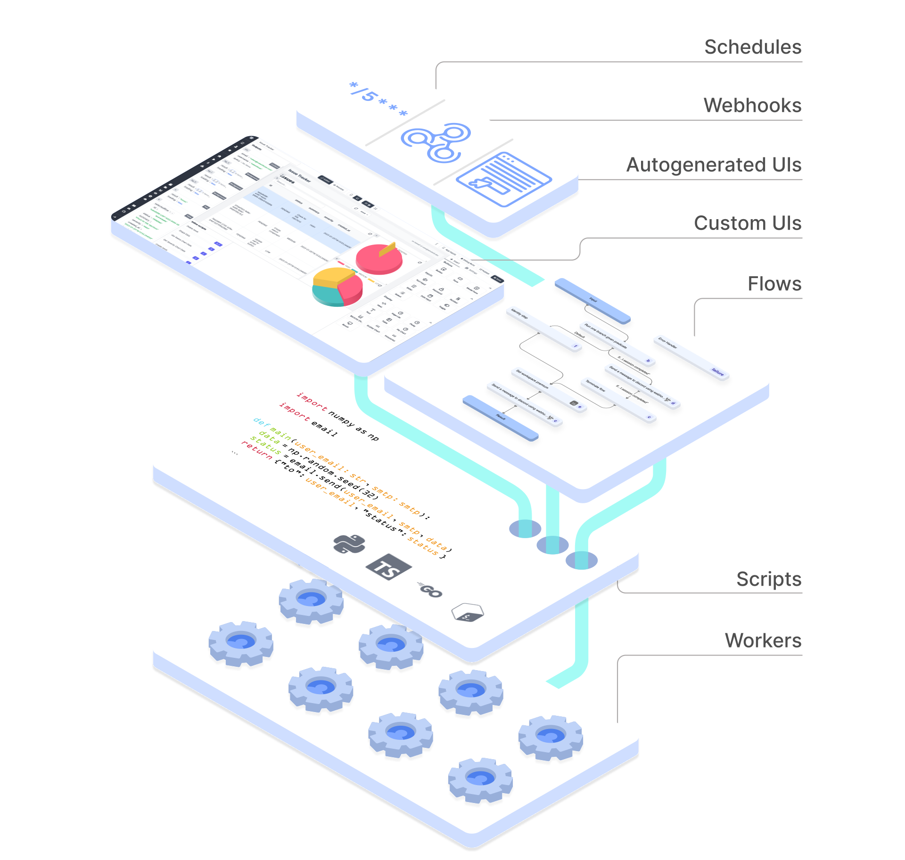
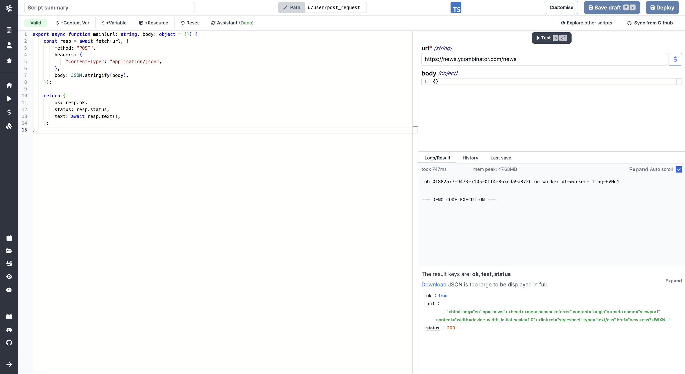
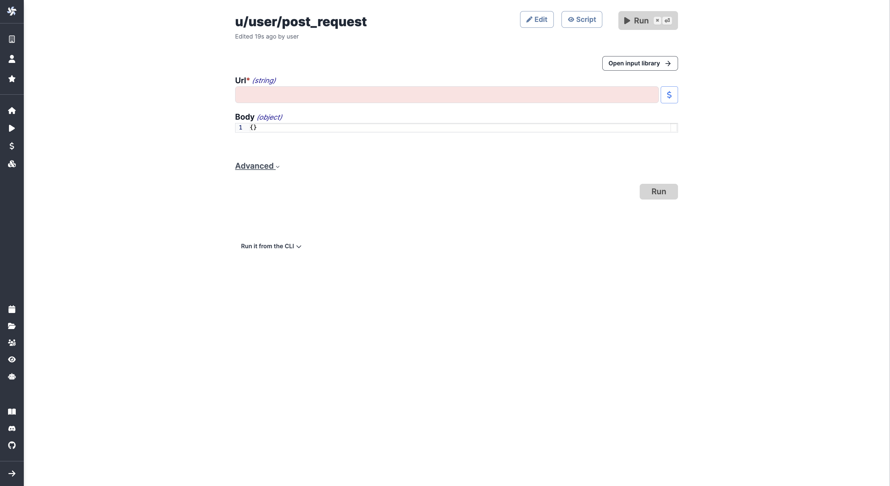
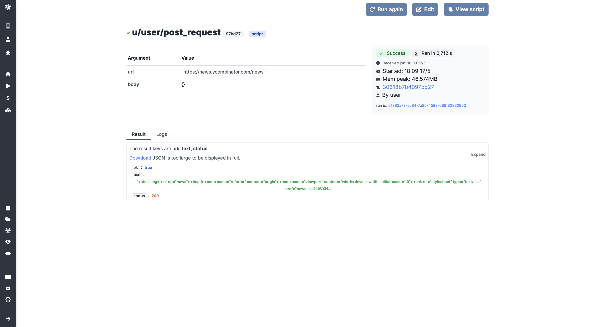
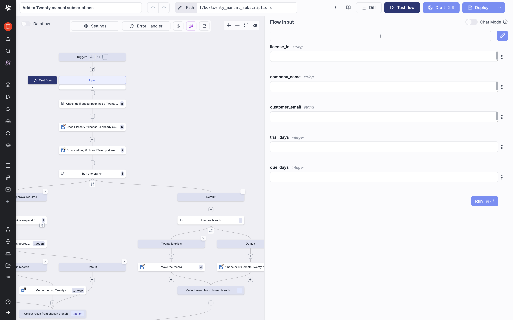
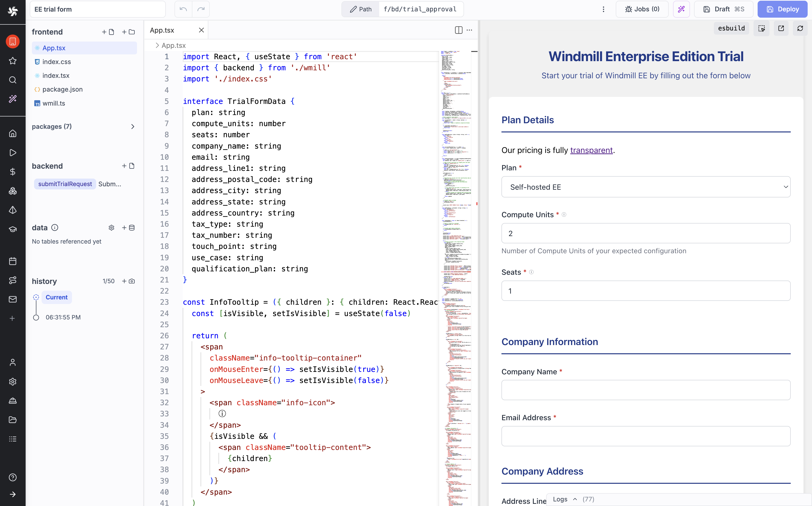
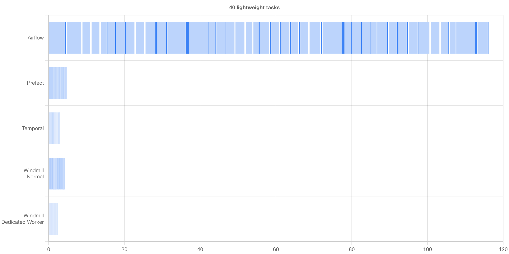
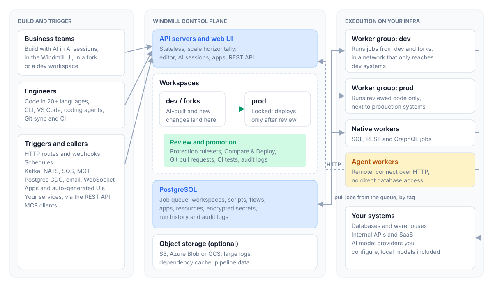

<p align="center">
  <a href="https://www.windmill.dev/"></a>
</p>

<p align=center>
Open-source, self-hostable code-first platform for workflows, apps and AI agents, running on the fastest self-hostable orchestrator. Engineers write code in 20+ languages and sync it with Git. Business teams build on the same platform with AI, while review, promotion between environments and isolated workers keep engineers in control of what ships. Self-hostable alternative to Lovable, Retool, n8n and a simplified Temporal.

<p align=center>
Scripts are turned into sharable UIs, APIs and cron jobs automatically, and can be composed together into flows, data pipelines, AI agents or full-code React and Svelte apps. Supported languages: Python, TypeScript, Go, Bash, SQL, GraphQL, PowerShell, Rust, and more.
</p>

<p align="center">
<a href="https://github.com/windmill-labs/windmill/blob/main/LICENSE-AGPL" target="_blank">
    
</a>
<a href="https://github.com/windmill-labs/windmill/actions/workflows/docker-image.yml" target="_blank">
    
</a>
<a href="https://pypi.org/project/wmill" target="_blank">
    
</a>
</p>

<p align="center">
<a href="https://img.shields.io/github/commit-activity/m/windmill-labs/windmill" target="_blank">
    
</a>
<a href="https://discord.gg/V7PM2YHsPB" target="_blank">
  
</a>
</p>

<p align="center">
  <a href="https://app.windmill.dev">Try it</a> - <a href="https://www.windmill.dev/">Website</a> - <a href="https://www.windmill.dev/docs/intro/">Docs</a> - <a href="https://discord.gg/V7PM2YHsPB">Discord</a> - <a href="https://hub.windmill.dev">Hub</a> - <a href="./CONTRIBUTING.md">Contributing</a>
</p>

# Windmill - Code-first platform for workflows, apps and AI agents

Windmill is fully open-sourced (AGPLv3) and Windmill Labs offers dedicated instances and commercial support and licenses.



https://github.com/user-attachments/assets/d80de1d9-64de-4d89-aacd-6df23fa81fc4

- [Windmill - Code-first platform for workflows, apps and AI agents](#windmill---code-first-platform-for-workflows-apps-and-ai-agents)
  - [Build with AI, ship with review](#build-with-ai-ship-with-review)
  - [Main Concepts](#main-concepts)
  - [What the code looks like](#what-the-code-looks-like)
  - [Data: data tables, DuckDB and DuckLake](#data-data-tables-duckdb-and-ducklake)
  - [Develop locally or in the browser](#develop-locally-or-in-the-browser)
  - [Stack](#stack)
  - [Fastest Self-Hostable Workflow Engine](#fastest-self-hostable-workflow-engine)
  - [Security](#security)
  - [Performance](#performance)
  - [Architecture](#architecture)
  - [How to self-host](#how-to-self-host)
    - [Docker compose](#docker-compose)
    - [Kubernetes (Helm charts)](#kubernetes-helm-charts)
    - [Cloud providers](#cloud-providers)
    - [OAuth, SSO \& SMTP](#oauth-sso--smtp)
    - [License](#license)
    - [Integrations](#integrations)
  - [Environment Variables](#environment-variables)
  - [Contributing](#contributing)
  - [Copyright](#copyright)

## Build with AI, ship with review

Business teams and engineers build on the same Windmill instance. What the AI builds is an ordinary script, flow or app, and goes through the same review as code written by engineers:

- [AI sessions](https://www.windmill.dev/docs/core_concepts/ai_sessions) build scripts, flows and apps with AI in a workspace fork, with a live preview and a diff to review before deploying.
- [Workspace roles](https://www.windmill.dev/docs/core_concepts/roles_and_permissions#workspace-roles) decide what each team can author, and [folders](https://www.windmill.dev/docs/core_concepts/groups_and_folders) scope the resources, skills and MCP servers its AI can reach.
- [Protection rulesets](https://www.windmill.dev/docs/core_concepts/protection_rulesets) block direct deployment, so changes reach production only after an engineer reviews and deploys them.
- [Dev workspaces](https://www.windmill.dev/docs/advanced/dev_workspaces) keep their own credentials, and promote to prod through Compare & Deploy or a Git pull request.
- [Worker groups](https://www.windmill.dev/docs/core_concepts/worker_groups) run AI-built code on its own workers, or on a [separate instance](https://www.windmill.dev/docs/core_concepts/staging_prod#deploy-to-a-workspace-on-another-instance).

See [let business teams build with AI safely](https://www.windmill.dev/docs/advanced/ai_guardrails) for the full setup. Engineers keep writing code locally with the [CLI](https://www.windmill.dev/docs/advanced/cli), the [VS Code extension](https://www.windmill.dev/docs/cli_local_dev/vscode-extension) and their coding agent, synced with [Git](https://www.windmill.dev/docs/advanced/git_sync).

## Main Concepts

1. Define a minimal and generic script in Python, TypeScript, Go or Bash that solves a specific task. The code can be defined in the provided Web IDE or synchronized with your own GitHub repo (e.g. through VS Code extension): [provided Web IDE](https://www.windmill.dev/docs/code_editor) or [synchronized with your own GitHub repo](https://www.windmill.dev/docs/advanced/cli/sync) (e.g. through [VS Code](https://www.windmill.dev/docs/cli_local_dev/vscode-extension) extension):



2. Your scripts parameters are automatically parsed and [generate a frontend](https://www.windmill.dev/docs/core_concepts/auto_generated_uis).





3. Make it [flow](https://www.windmill.dev/docs/flows/flow_editor)! You can chain your scripts or scripts made by the community shared on [WindmillHub](https://hub.windmill.dev).



4. Build [complex UIs](https://www.windmill.dev/docs/apps/app_editor) on top of your scripts and flows.



Scripts and flows can be triggered by [schedules](https://www.windmill.dev/docs/core_concepts/scheduling), [webhooks](https://www.windmill.dev/docs/core_concepts/webhooks), [HTTP routes](https://www.windmill.dev/docs/core_concepts/http_routing), [Kafka](https://www.windmill.dev/docs/core_concepts/kafka_triggers), [WebSockets](https://www.windmill.dev/docs/core_concepts/websocket_triggers), [emails](https://www.windmill.dev/docs/core_concepts/email_triggers), and more.

Build your entire infra on top of Windmill!

## What the code looks like

A script is a plain function. Its typed arguments become a generated form, an HTTP endpoint and a CLI command:

```typescript
import * as wmill from "windmill-client";
import dayjs from "dayjs"; // any npm package, resolved and pinned automatically

export async function main(
  customerId: string,
  plan: "starter" | "pro", // a union of strings becomes a dropdown
  trialDays = 14 // defaults infer the type
) {
  const trialEnd = dayjs().add(trialDays, "day").toISOString();

  // a data table: the workspace's Postgres, queried without a connection string
  const sql = wmill.datatable();
  await sql`INSERT INTO trials (customer_id, plan, trial_end) VALUES (${customerId}, ${plan}, ${trialEnd})`.fetch();

  // secrets are permissioned by path
  const slackToken = await wmill.getVariable("f/sales/slack_token");
  await fetch("https://slack.com/api/chat.postMessage", {
    method: "POST",
    headers: { Authorization: `Bearer ${slackToken}`, "Content-Type": "application/json" },
    body: JSON.stringify({ channel: "#sales", text: `New ${plan} trial: ${customerId}` }),
  });

  console.log(`Trial started for ${customerId}`); // logs stream live in the UI
  return { customerId, plan, trialEnd }; // returned as JSON
}
```

Workflows are code too. Each task runs as its own job with its own logs, and waiting for an approval releases the worker:

```typescript
import { task, waitForApproval, workflow } from "windmill-client";

async function plan(env: string) {
  return { env, changes: 3 };
}

async function apply(plan: { env: string; changes: number }) {
  return `applied ${plan.changes} changes to ${plan.env}`;
}

export const main = workflow(async (env: string) => {
  const changes = await task(plan)(env);
  const approval = await waitForApproval({ timeout: 3600 });
  if (!approval.approved) {
    return `rejected by ${approval.approver}`;
  }
  return await task(apply)(changes);
});
```

Flows can also be built in the visual [flow editor](https://www.windmill.dev/docs/flows/flow_editor) or as YAML, with scripts like the first one as steps. See [workflows as code](https://www.windmill.dev/docs/core_concepts/workflows_as_code).

## Data: data tables, DuckDB and DuckLake

- [Data tables](https://www.windmill.dev/docs/core_concepts/persistent_storage/data_tables) give each workspace managed Postgres tables, queried with type-checked SQL from TypeScript, Python and DuckDB scripts without exposing a connection string.
- [DuckDB](https://www.windmill.dev/docs/integrations/duckdb) scripts query S3 and Azure Blob files (CSV, Parquet, JSON), data tables, Postgres, MySQL and BigQuery in SQL, on your workers.
- [DuckLake](https://www.windmill.dev/docs/core_concepts/persistent_storage/ducklake) stores large datasets as lakehouse tables in your workspace object storage, queried in plain SQL.
- [Pipelines](https://www.windmill.dev/docs/core_concepts/pipelines) (alpha) wire scripts by the data they read and write instead of a hand-drawn DAG. This script runs whenever `events` is materialized, and materializes its own table:

```sql
-- pipeline
-- on ducklake://main/events
-- materialize ducklake://main/events_by_kind
ATTACH 'ducklake://main' AS dl;
SELECT kind, count(*) AS n
FROM dl.events
GROUP BY kind;
```

Existing [dbt projects](https://www.windmill.dev/docs/getting_started/scripts_quickstart/dbt) run unmodified as scripts. See the [pipelines quickstart](https://www.windmill.dev/docs/getting_started/pipeline_quickstart).

## Develop locally or in the browser

Engineers work from their editor and coding agent, business teams build with AI in the browser, and both land in the same workspace:

| Tool | Description |
|------|-------------|
| **[CLI](https://www.windmill.dev/docs/advanced/cli)** | Sync a workspace with local files and Git, run scripts and flows from the command line. `wmill init` generates `AGENTS.md` and [skill files](https://www.windmill.dev/docs/misc/guides/local_dev_with_ai) for Claude Code, Cursor and other AI tools |
| **[VS Code extension](https://www.windmill.dev/docs/cli_local_dev/vscode-extension)** | Edit and test scripts and flows from VS Code or Cursor with full IDE support |
| **[Git sync](https://www.windmill.dev/docs/advanced/git_sync)** | Two-way sync between a workspace and your Git repository |
| **[MCP server](https://www.windmill.dev/docs/core_concepts/mcp)** | Let coding agents and AI clients run scripts, manage resources and monitor jobs in a workspace |
| **[AI sessions](https://www.windmill.dev/docs/core_concepts/ai_sessions)** | The same agent loop in the browser, with nothing to install: plan mode, skills and MCP servers, a live preview, and a diff to review before deploying, in a fork of the workspace |

https://github.com/user-attachments/assets/c541c326-e9ae-4602-a09a-1989aaded1e9

You can run scripts locally by passing the right environment variables for the `wmill` client library to fetch resources and variables from your instance. See [local development docs](https://www.windmill.dev/docs/advanced/local_development).

## Stack

- **Database**: Postgres (compatible with Aurora, Cloud SQL, Neon, Azure PostgreSQL)
- **Backend**: Rust - stateless API servers and workers pulling jobs from a Postgres queue
- **Frontend**: Svelte 5
- **Sandboxing**: [nsjail](https://github.com/google/nsjail) and PID namespace isolation
- **Runtimes**:
  - TypeScript/JavaScript: Bun (default); Deno only on the `windmill-full` images
  - Python: python3 with uv for dependency management
  - PHP: only on the `windmill-full` images
  - Go, Bash, PowerShell, Rust, C#, Java, Ansible

## Fastest Self-Hostable Workflow Engine

We have compared Windmill to other self-hostable workflow engines (Airflow,
Prefect & Temporal) and Windmill is the most performant solution for both
benchmarks: one flow composed of 40 lightweight tasks & one flow composed of 10
long-running tasks.

All methodology & results on our
[Benchmarks](https://www.windmill.dev/docs/misc/benchmarks/competitors#airflow-setup)
page.



## Security

- **Sandboxing**: [nsjail](https://github.com/google/nsjail) for filesystem/resource isolation, and PID namespace isolation (enabled by default) to prevent jobs from accessing worker process memory
- **Secrets**: One encryption key per workspace for credentials stored in Windmill's K/V store. We recommend encrypting the Postgres database as well.

See [Security documentation](https://www.windmill.dev/docs/advanced/security_isolation) for details.

## Performance

Once a job started, there is no overhead compared to running the same script on
the node with its corresponding runner (Deno/Go/Python/Bash). The added latency
from a job being pulled from the queue, started, and then having its result sent
back to the database is ~50ms. A typical lightweight deno job will take around
100ms total.

## Architecture

Stateless API servers and workers share a PostgreSQL database that holds the job queue and all workspace state (remote agent workers go through the API servers instead). Workers pull jobs by tag, so each worker group can run in its own network, for example dev workers that only reach dev systems and prod workers that only run reviewed code.

<picture>
  <source media="(prefers-color-scheme: dark)" srcset="./imgs/architecture-dark.svg">
  
</picture>

## How to self-host

For detailed setup options, see [Self-Host documentation](https://www.windmill.dev/docs/advanced/self_host).

### Docker compose

Deploy Windmill with 3 files ([docker-compose.yml](./docker-compose.yml), [Caddyfile](./Caddyfile), [.env](./.env)):

```bash
curl https://raw.githubusercontent.com/windmill-labs/windmill/main/docker-compose.yml -o docker-compose.yml
curl https://raw.githubusercontent.com/windmill-labs/windmill/main/Caddyfile -o Caddyfile
curl https://raw.githubusercontent.com/windmill-labs/windmill/main/.env -o .env

docker compose up -d
```

Go to http://localhost - default credentials: `admin@windmill.dev` / `changeme`

**Using an external database**: Set `DATABASE_URL` in `.env` to point to your managed Postgres (AWS RDS, GCP Cloud SQL, Azure, Neon, etc.) and set db replicas to 0.

### Kubernetes (Helm charts)

```bash
helm repo add windmill https://windmill-labs.github.io/windmill-helm-charts/
helm install windmill-chart windmill/windmill --namespace=windmill --create-namespace
```

See [windmill-helm-charts](https://github.com/windmill-labs/windmill-helm-charts) for configuration options.

### Cloud providers

Windmill works on AWS (EKS/ECS), GCP, Azure, Ubicloud, Fly.io, Render.com, Hetzner, Digital Ocean, and others. Rule of thumb: 1 worker per 1vCPU and 1-2 GB RAM.

### OAuth, SSO & SMTP

Configure OAuth and SSO (Google Workspace, Microsoft/Azure, Okta) directly from the superadmin UI. [See documentation](https://www.windmill.dev/docs/misc/setup_oauth).

### License

- Using the Community Edition as is, internally or through its APIs, is free and needs no commercial license, within the limits and quotas set in the software.
- Selling, reselling or serving the Community Edition as a managed service, modifying or wrapping it, or re-exposing it to your users as a feature of your product (iframed public apps excepted) requires a commercial license: contact <sales@windmill.dev>.
- The binary built from this repository without the `enterprise` feature flag is open source under [AGPLv3](./LICENSE-AGPL): the same uses are then allowed under the AGPLv3 terms, or with a commercial license. The API clients and the OpenAPI spec are [Apache 2.0](./LICENSE-APACHE).

See [LICENSE](./LICENSE) for the full terms and [Pricing](https://www.windmill.dev/pricing) for plans.

### Integrations

In Windmill, integrations are referred to as [resources and resource types](https://www.windmill.dev/docs/core_concepts/resources_and_types). Each Resource has a Resource Type that defines the schema that the resource
needs to implement.

On self-hosted instances, you might want to import all the approved resource types from [WindmillHub](https://hub.windmill.dev). A setup script will prompt you to have it being synced automatically everyday.

## Environment Variables

The variables most deployments set:

| Environment Variable name | Default               | Description                                                                                                  | Api Server/Worker/All |
| ------------------------- | --------------------- | ------------------------------------------------------------------------------------------------------------ | --------------------- |
| DATABASE_URL              |                       | The Postgres database url.                                                                                   | All                   |
| MODE                      | standalone            | The mode of the binary: standalone, server, worker, agent (EE), indexer (EE image, full-text search), mcp    | All                   |
| WORKER_GROUP              | default               | The worker group the worker belongs to and gets its configuration pulled from                                | Worker                |
| BASE_URL                  | http://localhost:8000 | The base url that is exposed publicly to access your instance. Is overriden by the instance settings if any. | Server                |
| LICENSE_KEY (EE only)     | None                  | License key checked at startup for the Enterprise Edition of Windmill                                        | Worker                |

All other variables (database pool, queue, runtimes, private registries, certificates, zombie jobs and more) are documented in the [environment variables reference](https://www.windmill.dev/docs/core_concepts/environment_variables).

## Contributing

At this time, we are not seeking outside contribution. Bug reports and feature requests remain very
welcome, and small, trivially-verified PRs that fix a problem are still accepted. See
[CONTRIBUTING.md](./CONTRIBUTING.md) for the full policy.

To run Windmill from source, see [frontend/README_DEV.md](./frontend/README_DEV.md).

## Copyright

© 2023-2026 Windmill Labs, Inc.
